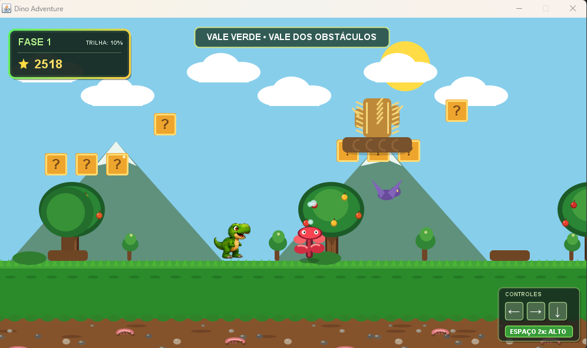

# Dino Adventure

Jogo de plataforma 2D desenvolvido em **Java 17, Swing e Java2D** como projeto acadêmico de Análise e Desenvolvimento de Sistemas. O jogador controla um dinossauro, supera obstáculos e avança por um mapa de fases com salvamento local.

O projeto explora programação orientada a objetos, eventos, animação, colisões, câmera lateral, persistência e testes automatizados.



*Captura de uma versão anterior com os recursos visuais originais. Os arquivos dessas imagens ainda precisam ser adicionados a esta distribuição.*

## Estado do projeto

**Em desenvolvimento.** A seleção exibe dois mundos e dez posições de fases. O primeiro mundo concentra as mecânicas mais desenvolvidas; as dez posições não representam dez fases finalizadas com conteúdo exclusivo. Chefes, áudio e expansão dos cenários fazem parte das próximas etapas.

**As imagens originais serão inseridas posteriormente em `src/main/resources/assets/`.** A compilação e os testes não dependem delas. Para experimentar a apresentação visual e o personagem corretamente, adicione os arquivos conforme o [guia de recursos](src/main/resources/assets/README.md).

## Mecânicas implementadas

- Movimento lateral, ação de abaixar e salto com impulso extra no segundo toque.
- Animações com quadros individuais ou spritesheets de oito quadros.
- Menu, instruções, seleção de fases e mapa da aventura.
- Colisões, pontuação, portal de conclusão e desbloqueio de fases.
- Salvamento automático do progresso com `java.util.prefs.Preferences`.
- Vale dos Obstáculos com câmera lateral, blocos, frutas, plantas e inimigos voadores.
- Fruta especial com crescimento temporário, imunidade e partículas.
- Reinício do Vale dos Obstáculos após a derrota, restaurando os blocos da tentativa.

## Tecnologias e requisitos

| Item | Uso |
| --- | --- |
| JDK 17 ou superior | Compilação e execução |
| Swing e Java2D | Janela, entrada, animação e renderização |
| Maven 3.9 ou superior | Build e ciclo de testes |
| JUnit 5 | Testes; não é incluído como dependência do jogo |
| GitHub Actions | Verificação configurada para Linux e Windows |
| IntelliJ IDEA | IDE opcional |

O código de produção usa apenas bibliotecas do JDK. A execução gráfica exige um ambiente de desktop. Os testes usam renderização offscreen e podem rodar sem janela.

## Começar

### Abrir o pacote já compilado no Windows

Extraia todo o ZIP e execute **`JOGAR.bat`**. O atalho usa `dist/dino-adventure.jar` e procura um Java 17 ou superior no sistema e nas pastas comuns de JDK do IntelliJ. Não exige Maven. Consulte `LEIA_PRIMEIRO.txt`.

Os fontes e o `pom.xml` ficam diretamente na pasta extraída, sem uma segunda pasta de projeto interna. As imagens originais continuam sendo adicionadas separadamente em `src/main/resources/assets/`.

### IntelliJ IDEA

1. Abra a pasta que contém `pom.xml` como projeto Maven.
2. Selecione um JDK 17 ou superior e aguarde a importação das dependências de teste.
3. Copie o conteúdo dos seus assets para `src/main/resources/assets/`, preservando nomes e subpastas.
4. Execute `br.com.dinoadventure.app.Main`.

Não crie uma pasta `assets/assets/`. Por exemplo, o arquivo original `assets/menu.png` deve ficar em `src/main/resources/assets/menu.png`.

### Maven

Na raiz do projeto:

```bash
mvn clean verify
java -jar target/dino-adventure.jar
```

O primeiro comando compila, executa os testes e gera o JAR com os recursos presentes em `src/main/resources/`. Após adicionar ou substituir imagens, recompile.

### Atalhos de terminal

| Objetivo | Windows | Linux / macOS |
| --- | --- | --- |
| Compilar e executar com o JDK | `executar.bat` | `bash scripts/projeto.sh run` |
| Somente gerar o JAR com o JDK | `powershell -NoProfile -File scripts/projeto.ps1 build` | `bash scripts/projeto.sh build` |
| Build e testes com Maven | `verificar.bat` | `bash scripts/projeto.sh verify` |

Os atalhos de execução e compilação precisam apenas do JDK. O modo `verify` precisa também do Maven e, no primeiro uso, de internet para baixar suas dependências.

## Controles

| Tecla / entrada | Ação |
| --- | --- |
| Seta direita / esquerda | Mover |
| Seta para baixo | Abaixar |
| Espaço | Pular |
| Soltar e pressionar espaço novamente | Impulso extra no ar |
| Enter | Abrir seleção / iniciar a fase selecionada |
| Esc | Voltar nas telas de menu e mapas |
| D | Reiniciar na tela de derrota |
| Mouse | Selecionar botões, mundos e fases |

## Organização

Os fontes de produção ficam em `src/main/java/br/com/dinoadventure/`.

| Área | Responsabilidade |
| --- | --- |
| `app/Main.java` | Iniciar a janela na thread de eventos do Swing |
| `jogo/PainelJogo.java` | Coordenar a partida, eventos e regras de atualização |
| `jogo/TelaJogo.java` | Representar a única tela ativa |
| `jogo/ConfiguracaoJogo.java` | Centralizar parâmetros compartilhados do percurso |
| `jogo/GeradorBlocosVale.java` | Gerar blocos de forma determinística |
| `jogo/RenderizadorVale.java` | Desenhar obstáculos e inimigos |
| `jogo/RenderizadorMapas.java` e `DadosMapa.java` | Desenhar mapas a partir de dados de leitura |
| `jogo/RenderizadorHud.java` e `ResumoPartida.java` | Desenhar pontuação, controles e mensagens |
| Demais entidades em `jogo/` | Representar blocos, frutas, plantas, inimigos e partículas |
| `grafico/DesenhosCenario.java` | Desenhos reutilizáveis, sem acesso ao estado da partida |
| `recursos/GerenciadorRecursos.java` | Ler imagens de arquivos e de dentro do JAR |
| `persistencia/RepositorioProgresso.java` | Ler e gravar progresso local |
| `src/test/java/` | Testes de comportamento, navegação e geração do percurso |

Consulte a [arquitetura e as decisões](docs/ESTRUTURA.md) para entender a divisão e os limites atuais.

## Testes

```bash
mvn test
```

A suíte contém 12 testes JUnit, com verificações de persistência, limites de progresso, sprites, recursos dentro de JAR, salto duplo, blocos, renderização offscreen, navegação e isolamento das tentativas.

Os relatórios ficam em `target/surefire-reports/`. Os testes usam nós temporários de preferências e não alteram o progresso normal do jogador. Testes gráficos são executados na thread de eventos do Swing.

O workflow executa `mvn clean verify` em Linux com Java 17 e 21 e Windows com Java 17. Disponibiliza relatórios de testes e um JAR como artefatos da execução. O resultado efetivo ficará disponível na aba **Actions** depois do envio ao GitHub.

A suíte automatizada não substitui a validação manual da jogabilidade com as imagens originais.

## Persistência

O progresso fica no perfil local do usuário, por meio de `Preferences`; não é armazenado na pasta do repositório. A implementação mantém o nó legado para preservar os salvamentos da versão anterior.

No Vale dos Obstáculos, morrer zera a tentativa e restaura os blocos, preservando o avanço desbloqueado. Checkpoints permitem retomar uma tentativa salva que ainda não terminou em derrota.

## Evolução planejada

- Extrair gradualmente a física e as regras restantes do coordenador da partida.
- Evoluir o controle de tempo da simulação e o salvamento fora da thread gráfica.
- Versionar o formato de progresso antes de alterar a identidade ou a ordem dos blocos.
- Expandir cenários, chefes e áudio.
- Inserir os assets originais e registrar seus créditos.

Veja [como publicar no GitHub](docs/PUBLICAR_NO_GITHUB.md), [como contribuir](CONTRIBUTING.md) e o [histórico de alterações](CHANGELOG.md).
